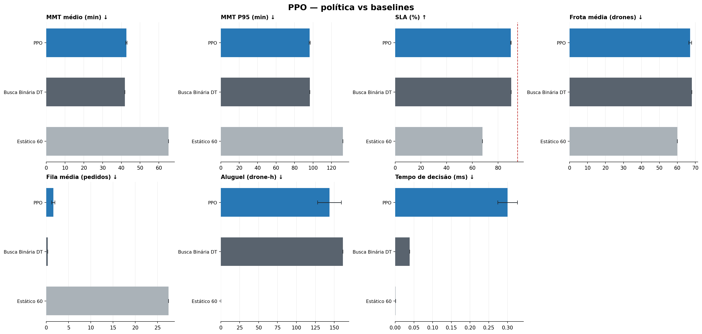
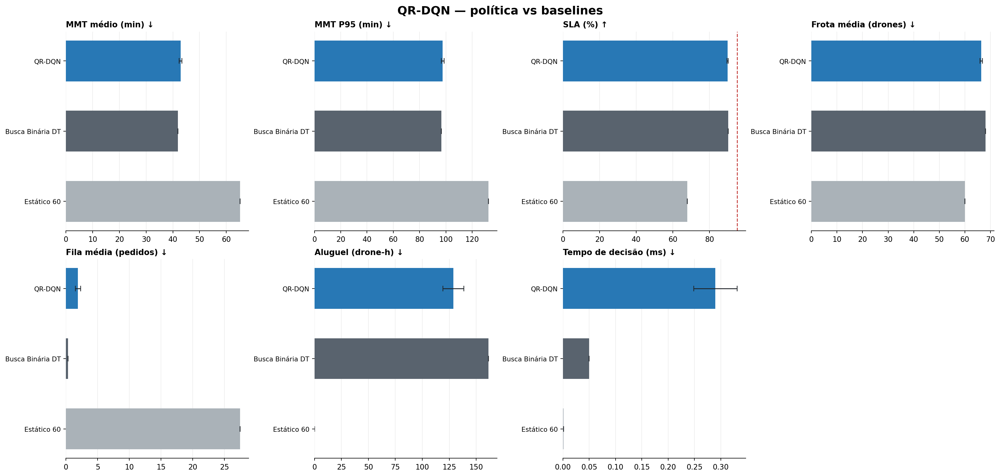
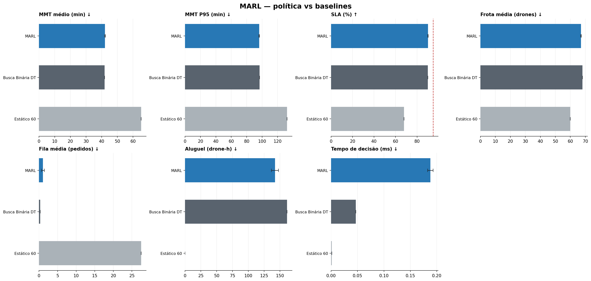
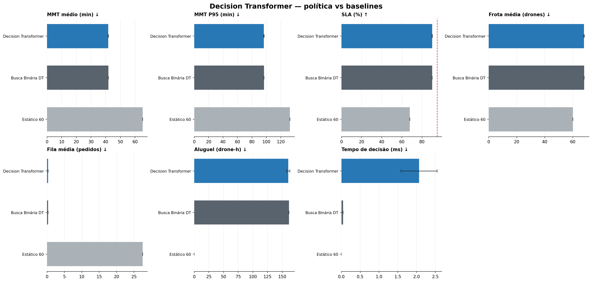

# Análise comparativa final das políticas — 2026-10-23

## Estado da comparação

A retomada do Decision Transformer foi concluída em `rl_resultados/experimentos/dt/dt_reexec_20261023/`. Agora há cinco algoritmos completos: DQN, PPO, QR-DQN, MARL e Decision Transformer. Cada um tem cinco modelos treinados (seeds 42–46) e avaliação nos mesmos 30 cenários (seeds 1–30). O CSV do DT contém 450 linhas: 5 modelos × 30 cenários × 3 políticas (DT, Busca Binária DT e Estático 60). Foram encontrados os cinco checkpoints e os resumos agregados.

Os dados foram importados com `sep=';'` e `decimal=','`. Na tabela, `±` é o desvio padrão entre as cinco seeds de treino; não é o erro padrão dos 150 episódios. As métricas de baseline são mantidas uma vez. O tempo de decisão do DT tem maior variação porque é medição de tempo de execução, sujeita a ruído de máquina.

## Resultado por política

| Política | MMT médio (min) ↓ | MMT P95 (min) ↓ | SLA (%) ↑ | Frota média ↓ | Fila média ↓ | Aluguel (drone-h) ↓ | CPU/decisão (ms) ↓ |
|---|---:|---:|---:|---:|---:|---:|---:|
| DQN | 42,775 ± 0,816 | 97,019 ± 1,138 | 89,882 ± 0,448 | 66,734 ± 0,626 | 1,785 ± 0,915 | 134,682 ± 12,522 | 0,167 ± 0,002 |
| PPO | 42,660 ± 0,343 | 96,460 ± 0,700 | 89,921 ± 0,216 | 67,185 ± 0,780 | 1,577 ± 0,368 | 143,699 ± 15,613 | 0,300 ± 0,026 |
| QR-DQN | 42,915 ± 0,510 | 97,556 ± 1,035 | 89,833 ± 0,305 | 66,440 ± 0,486 | 1,895 ± 0,428 | 128,791 ± 9,733 | 0,290 ± 0,041 |
| MARL | 42,140 ± 0,315 | 96,294 ± 0,517 | 90,203 ± 0,178 | 67,115 ± 0,281 | 1,061 ± 0,383 | 142,289 ± 5,629 | 0,188 ± 0,005 |
| Decision Transformer | **41,774 ± 0,146** | 96,496 ± 0,528 | 90,180 ± 0,122 | 68,011 ± 0,140 | **0,330 ± 0,012** | 160,214 ± 2,788 | 2,065 ± 0,479 |
| Busca Binária DT | 41,840 | 96,626 | 90,127 | 68,073 | 0,320 | 161,453 | 0,044 |
| Estático 60 | 65,146 | 132,468 | 67,930 | 60,000 | 27,476 | 0,000 | 0,001 |

## Interpretação como comparação experimental

- O **Decision Transformer reproduziu muito de perto a Busca Binária DT**, que gerou as trajetórias de demonstração. O MMT médio ficou 0,066 min abaixo do baseline e o SLA 0,053 ponto percentual acima; fila, frota e aluguel também ficaram muito próximos.
- A análise pareada por seed de cenário (30 cenários; bootstrap de 10.000 reamostragens, condicionada aos cinco modelos treinados) não separa DT de Busca Binária DT nas seis métricas analisadas: os ICs de 95% incluem zero. Para MMT, diferença DT − baseline = −0,066 min, IC [−0,222; 0,087]; para SLA = +0,053 ponto percentual, IC [−0,087; 0,183]. Isso não demonstra equivalência formal, mas não há evidência de ganho operacional neste protocolo.
- O resultado é coerente com o desenho do método: o DT foi treinado para imitar trajetórias do controlador DT com exploração de 15%. O achado principal é que a política aprendeu um comportamento próximo ao demonstrador; não que tenha descoberto uma política melhor.
- A latência de inferência do DT foi 2,065 ± 0,479 ms, maior que DQN/PPO/QR-DQN/MARL. Ainda é pequena em escala de simulação, mas deve ser considerada se o limite operacional de decisão for apertado e medida novamente com protocolo de benchmark controlado.
- **MARL** mantém o melhor resultado pontual de SLA entre métodos aprendidos (90,203%) e a menor fila entre eles (1,061), enquanto **QR-DQN** usa menos aluguel (128,791 drone-h) e frota (66,440). Essas escolhas envolvem trocas entre serviço e recursos.
- **DT tem o menor MMT médio pontual** entre todos (41,774 min), pouco abaixo da Busca Binária DT (41,840). Esse valor isolado não sustenta superioridade; o intervalo pareado inclui zero. A menor fila pontual também é do baseline (0,320), praticamente igual ao DT (0,330).
- Nenhuma política chegou à meta de SLA de 95%. A escolha final depende de uma função de custo operacional explícita. Se a prioridade for imitar o controlador atual, DT funciona; se a meta for melhorar serviço/custo, esta execução não prova que DT ofereça vantagem.

## Painéis separados

O [notebook de visualização](visualizacao_resultados_rl.ipynb) traz auditoria dos CSVs, valores por seed de treino e diferenças pareadas bootstrap contra Busca Binária DT.

## Limitações

- Cinco seeds de treinamento ainda são uma amostra pequena para estimar a distribuição de desempenho entre treinos.
- O bootstrap pareado reamostra cenários de avaliação, mas é condicional aos cinco checkpoints e não modela toda a incerteza de treinamento.
- As comparações assumem que as versões do ambiente e os parâmetros foram mantidos constantes entre execuções. Os baselines foram reexecutados dentro de cada algoritmo; pequenas variações de cronometragem não devem ser interpretadas como efeito de política.
- A coleta do DT usa o próprio baseline DT como demonstrador. Para testar descoberta de desempenho, seria necessário ampliar/diversificar o dataset, comparar diferentes níveis de retorno desejado e avaliar contra demonstrações alternativas sem contaminar os cenários de teste.
- A execução `--algo all` original interrompeu no DT, portanto não produziu sua consolidação automática. A comparação completa foi recomposta dos resumos individuais, usando DQN/PPO/QR-DQN/MARL de `20261023_122550_*` e DT de `dt_reexec_20261023`.

## Artefatos

- Tabela comparativa reproduzível: `rl_resultados/comparacao_algoritmos_final_20261023.csv` (separador `;`, decimal `,`).
- Notebook: [visualizacao_resultados_rl.ipynb](visualizacao_resultados_rl.ipynb).
- Execuções DQN/PPO/QR-DQN/MARL: `rl_resultados/experimentos/{dqn,ppo,qrdqn,marl}/20261023_122550_<algoritmo>/`.
- Execução Decision Transformer: `rl_resultados/experimentos/dt/dt_reexec_20261023/`.
- Painéis: `rl_resultados/comparacao_por_algoritmo_{dqn,ppo,qrdqn,marl,dt}.png`.
- Histórico, incluindo correção do padding e retomada: [HISTORICO_DESENVOLVIMENTO_RL.md](HISTORICO_DESENVOLVIMENTO_RL.md).
